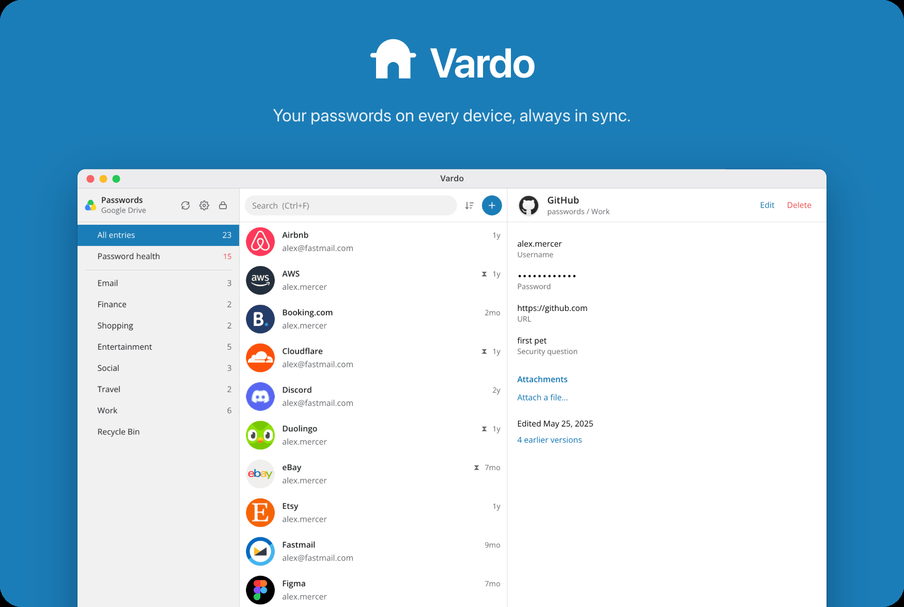

<picture>
  <source media="(prefers-color-scheme: dark)" srcset="docs/images/hero-dark.png">
  
</picture>

<p align="center">
  <a href="#on-your-computer"></a>
  <a href="#on-your-computer"></a>
  <a href="#on-your-computer"></a>
  <br>
  <a href="#in-your-browser"></a>
  <a href="#in-your-browser"></a>
  <a href="https://apps.apple.com/app/keepassium-password-manager/id1435127111"></a>
  <a href="https://play.google.com/store/apps/details?id=com.kunzisoft.keepass.free"></a>
</p>

<p align="center">
  <a href="https://github.com/cornellsh/vardo/actions/workflows/ci.yml"></a>
  <a href="#license"></a>
</p>

Vardo keeps your passwords in one encrypted file in your Google Drive or on your own server. The desktop app, the browser extension and a KeePass app on your phone all open that same file, so a password you save on one device shows up on the others.

## Your passwords stay yours

There's no account to create, no subscription and no Vardo server. The file is encrypted on your device before it goes anywhere, and only your master password can open it. That also means nobody can get you back in if you forget it.

## Getting started

Every device opens the same password file, kept in Google Drive or on a WebDAV server. If you already use KeePass, keep using the file you have. If you're starting fresh, create a new file in KeePassium or KeePassDX on your phone (see the phone section below) and save it to Google Drive. Vardo can't create one yet.

### On your computer

Download the app from the [Releases page](https://github.com/cornellsh/vardo/releases/latest).

| Computer | File |
| --- | --- |
| Mac with Apple Silicon | `Vardo_…_aarch64.dmg` |
| Mac with Intel | `Vardo_…_x64.dmg` |
| Windows | `Vardo_…_x64-setup.exe` |
| Linux | `.deb` or `.AppImage` |

The builds aren't signed yet, so your computer will warn you the first time you open Vardo.

On a Mac, drag Vardo into Applications and open it. When macOS says it can't be opened, go to System Settings, open Privacy & Security, and click Open Anyway.

On Windows, run the installer. When Windows warns you, click More info and then Run anyway.

On Linux, install the `.deb`, or make the `.AppImage` executable and run it.

Once Vardo is running, choose where your file lives (Google Drive, WebDAV, or Open a file for one on this computer) and enter your master password. Do the same on your other computers and pick the same file.

The first time, Vardo asks whether to check for updates once a day. Say yes and it downloads new versions itself, then asks you to restart when one is ready. You can change this, or check by hand, in Settings.

On a Mac, the first time Vardo opens after an update, macOS asks for your login password before Vardo can read a saved Google or WebDAV sign-in. Click Always Allow.

### In your browser

The extension isn't in the browser stores yet, so you add it yourself.

In Chrome, Edge, Brave or Vivaldi, open Settings in the Vardo app and click Connect next to your browsers. Vardo then shows a folder. Open the browser's extensions page, switch on Developer mode, click Load unpacked and choose that folder. The extension in it updates with Vardo, and the browser picks up the new version when it restarts.

In Firefox, download `vardo-extension-firefox-….zip` from the [Releases page](https://github.com/cornellsh/vardo/releases/latest) and unzip it. Go to `about:debugging`, click This Firefox, then Load Temporary Add-on, and choose the `manifest.json` file inside the folder. Firefox forgets temporary add-ons when it restarts, so you'll have to repeat this until Mozilla signs the extension. Then click Connect in Vardo's Settings.

On a login page, click the Vardo button in the toolbar or press Alt+Shift+L to fill in your details. The extension gets your passwords from the app, so keep Vardo running.

### On your phone

There's no Vardo phone app. Your phone opens the same file in a KeePass app instead: [KeePassium](https://apps.apple.com/app/keepassium-password-manager/id1435127111) on iPhone and iPad, or [KeePassDX](https://play.google.com/store/apps/details?id=com.kunzisoft.keepass.free) on Android.

Open your file from Google Drive or your WebDAV server. KeePassDX opens files through Android's file picker, so if your file is in Google Drive, install the Google Drive app first.

To fill passwords in other apps, turn on autofill. On iPhone, go to Settings, then General, then AutoFill & Passwords, and turn on KeePassium. On Android, find Autofill service in Settings (usually under Passwords & accounts) and pick KeePassDX.

When you change a password on one device, the others pick it up the next time they sync. If two devices changed the same login, Vardo shows you both versions and asks which one to keep.

<details>
<summary>Build from source</summary>

You need Rust 1.90+, Node 22, and your system's build tools (on Linux, WebKitGTK 4.1 and an AppIndicator library).

```sh
git clone https://github.com/cornellsh/vardo
cd vardo/app
npm ci
npm run app:release
```

The app lands in `target/release/vardo-app`. Try it with `fixtures/test_db_kdbx4_with_password_argon2id.kdbx`, password `demopass`.

Google Drive sync needs your own Google sign-in key ([how](docs/RUNBOOKS.md#create-a-google-oauth-client)). The browser extension is in `extension/`; connect it from Settings in the app.

</details>

## License

[Apache 2.0](LICENSE-APACHE) or [MIT](LICENSE-MIT), your choice.
