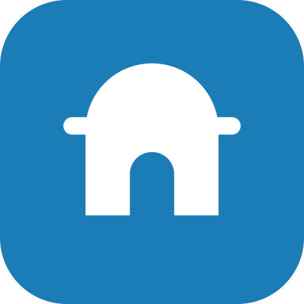
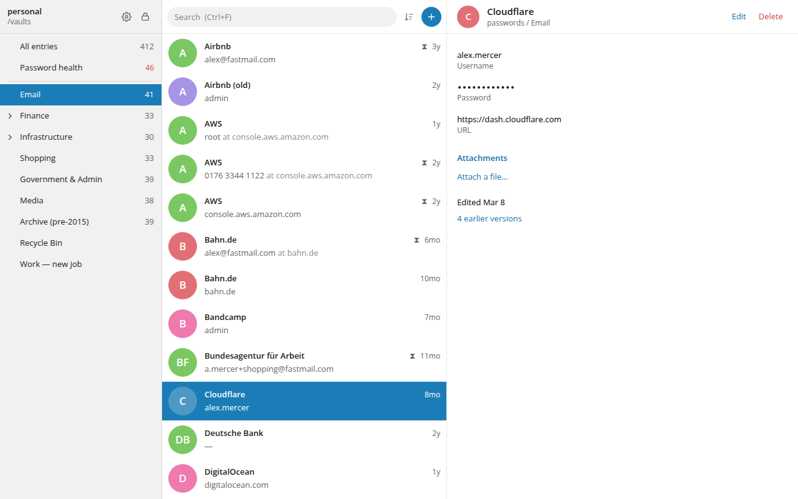

<p align="center">
  
</p>

<h1 align="center">Vardo</h1>

<p align="center">
  A password manager for your desktop that keeps your passwords in a file you own.
</p>

<p align="center">
  <a href="https://github.com/cornellsh/vardo/actions/workflows/ci.yml"></a>
  <a href="#license"></a>
</p>

<picture>
  <source media="(prefers-color-scheme: dark)" srcset="docs/images/vardo-dark.png">
  
</picture>

Vardo keeps your passwords in a KeePass file, the same `.kdbx` format used by
KeePassXC on the desktop and KeePassium on the iPhone. You can keep that file on
your computer, or keep it in your Google Drive and let Vardo keep your devices
in step.

There is no account to create, no subscription, and no company server holding
your passwords. If Vardo disappeared tomorrow, any KeePass app would open your
file exactly as before.

> [!IMPORTANT]
> **Vardo is early software.** It works, and its author uses it every day, but it
> has not been independently audited and there are no ready-made downloads yet.
> Keep a backup copy of your password file while you try it.

## Contents

- [Why Vardo exists](#why-vardo-exists)
- [What it can do](#what-it-can-do)
- [What it cannot do yet](#what-it-cannot-do-yet)
- [Is it safe?](#is-it-safe)
- [Google Drive, explained](#google-drive-explained)
- [The browser extension](#the-browser-extension)
- [Installing](#installing)
- [Everyday use](#everyday-use)
- [Questions people ask](#questions-people-ask)
- [For developers](#for-developers)
- [License](#license)

## Why Vardo exists

Password managers usually make you choose.

**Cloud services** such as 1Password and Bitwarden are convenient. Your
passwords appear on every device. But they live on the company's servers, in
the company's format, behind the company's subscription.

**KeePass apps** let you keep the file yourself, but syncing it between devices
is your problem. Most people put the file in Dropbox or Google Drive and hope.
That works until two devices save at the same moment, and then one set of
changes quietly disappears.

Vardo tries to give you both:

- **Your passwords stay in an ordinary file that you control.** Copy it, back it
  up, open it in another app. Nothing about it is special to Vardo.
- **Syncing is built in, and it does not lose changes.** If you edit a login on
  your laptop and a different one on your phone, Vardo combines both instead of
  letting one overwrite the other. When it cannot tell which version you meant,
  it shows you both and asks.
- **It is pleasant to use.** Vardo borrows the calm look of a modern messaging
  app rather than the spreadsheet look of older password managers.

## What it can do

**Open your vault**

- Unlock with your master password.
- Pick a file on your computer, or a file in your Google Drive.
- Vardo remembers the vaults you have opened, so next time it is one click.

**Find and use a password**

- Search as you type.
- Click a username or password to copy it. Your clipboard is cleared again after
  15 seconds.
- Reveal a password on screen when you need to read it.
- See two-factor codes (the six-digit codes that change every 30 seconds) next
  to the login they belong to.

**Keep things organised**

- Folders inside folders, which KeePass calls groups. Create, rename and delete
  them.
- Tags, expiry dates, notes and extra fields of your own.
- File attachments up to 8 MB each, such as recovery codes or a scanned card.
- Sort by name or by when you last changed something.
- Each site's icon, fetched once and stored inside your vault.

**Look after your passwords**

- A **password health** page lists passwords that are reused, weak, expired or
  very old.
- A password generator.
- Every change keeps the previous version, so you can look back at an old
  password if a site still expects it.

**Sign in to websites**

- A browser extension for Chrome, Brave, Edge, Vivaldi and Chromium fills
  your username and password, and the two-factor code on the page after.
- Press <kbd>Alt</kbd>+<kbd>Shift</kbd>+<kbd>L</kbd>, or click the Vardo button
  in the toolbar and choose a login.
- See [The browser extension](#the-browser-extension) for what it can and
  cannot see.

**Stay safe while you work**

- Vardo locks itself after 5 minutes without use.
- Closing the window keeps Vardo in the system tray, so you do not have to type
  your master password every time. The tray icon shows whether your vault is
  locked or unlocked.
- Every save is checked before your old file is replaced (see
  [Is it safe?](#is-it-safe)).

## What it cannot do yet

It is better that you know this before you start than after.

- **The browser extension is new.** It works in Chromium-based browsers on
  Linux and macOS, you install it by hand, and it does not yet offer to save a
  login you have just created. Firefox, Safari and Windows come later.
- **No phone app.** Use [KeePassium](https://keepassium.com) on iPhone and iPad,
  or [KeePassDX](https://www.keepassdx.com) on Android, with the same file.
- **Master password only.** Key files, YubiKeys, and unlocking with your
  fingerprint or Windows Hello are not supported.
- **No installers to download.** For now you build Vardo yourself, which takes
  a few commands (see [Installing](#installing)).
- **Used daily on Linux only.** It should work on Windows and macOS, and its
  core is tested on all three systems automatically, but nobody uses it there
  day to day yet.
- **Google Drive is the only built-in sync.** You can keep your file in a
  Dropbox or OneDrive folder, but those apps copy files on their own schedule
  and can lose changes when two devices save at once. Vardo warns you when it
  sees your vault in one of those folders.
- **No settings screen.** The auto-lock time and clipboard time are fixed.
- **Older KeePass files open read-only.** Files in the old KDBX 3.1 format can
  be viewed but not changed. Opening and saving them once in KeePassXC converts
  them to the current format.

## Is it safe?

The honest answer: it is built carefully, it is tested heavily, and nobody
independent has checked it yet. Here is what that means in practice.

**Vardo does not invent its own encryption.** It uses the KeePass file format,
which has been public and widely studied for many years. Your whole vault is
encrypted with AES-256 or ChaCha20, and your master password is run through
Argon2, a method designed to make guessing slow and expensive. That is why
unlocking takes about a second. The pause is intentional.

**Nobody can recover a forgotten master password**, including Vardo. There is
no reset link, because there is no server to send one from. Write it down
somewhere safe if you are worried about forgetting it.

**Your passwords are kept away from the visible part of the app.** Vardo's
window is drawn with web technology, which is good at looking nice and bad at
keeping secrets in memory. So passwords stay in a separate part of the program
written in Rust. The window only receives a password when you click **Show**,
and copying goes straight from that separate part to your clipboard.

**Every save is checked before it counts.** Vardo writes the new file, opens it
again to make sure it decrypts correctly, and only then replaces your old one.
If anything goes wrong, your previous file is untouched. For files on your
computer, the last 5 versions are also kept as backups next to the file.

**It is tested against the apps you might already use.** Files written by
Vardo are opened by KeePassXC as part of the automated tests. Hundreds of tests
run on every change, and the code that reads files has been fed about 15
million deliberately broken inputs to make sure it fails safely instead of
crashing or misbehaving.

**What Vardo connects to.** Nothing, unless you ask it to. There is no
analytics and no tracking. It goes online for two things only:

- **Google Drive,** if you choose to use it.
- **Site icons.** When you open a login that has no icon, Vardo asks that
  website for its icon, once, and saves it in your vault. It asks the website
  directly, not a third-party icon service, so nobody else learns which sites
  you use.

The browser extension talks only to Vardo on your own computer, never to the
internet.

**Found a security problem?** Please report it privately, as described in
[SECURITY.md](SECURITY.md), rather than in a public issue.

## Google Drive, explained

**Vardo can only see the files you give it.** When you sign in, Google asks
whether Vardo may access "files you use with this app". That is a narrow
permission: Vardo can see files it created and files you choose for it, and
nothing else in your Drive. It cannot list, read or change your other files.

That has one consequence that surprises people. **A vault that is already in
your Drive will not appear in Vardo's list at first.** Choose **Google Drive**,
then **Choose from Drive**, and pick it once. From then on it is remembered.

**You sign in through your own web browser,** not a window inside Vardo. That
way you can see that the page really is Google's, with your saved logins and
security keys working as usual.

**When two devices change the vault at the same time,** Vardo downloads the
latest copy and combines the two:

- Changes to different logins are simply kept, both of them.
- If the same login was changed on both devices, the newer version wins, and the
  older one is kept in that login's history, so nothing is thrown away.
- If Vardo cannot tell which change came first, it shows you both and lets you
  decide.

Vardo never overwrites a copy in Drive that changed since you opened it. If
that happens, it tells you, and you sync first so both sets of changes are kept.

> [!NOTE]
> If you build Vardo yourself, Google Drive needs a free Google Cloud setup
> first, because Google requires every app to identify itself.
> [docs/google-drive-setup.md](docs/google-drive-setup.md) walks through it in
> about ten minutes. Files on your computer work without it.

## The browser extension

The extension fills logins into websites. It is deliberately built so that it
**cannot see anything until you ask it to fill**.

**What happens when you use it.** Press <kbd>Alt</kbd>+<kbd>Shift</kbd>+<kbd>L</kbd>
on a sign-in page. If you have exactly one login saved for that site, Vardo
fills it. Otherwise a small window opens next to the toolbar, listing the
logins for that site, so you can pick one. On the next page, if the site asks
for a two-factor code, the same key fills the code. It never presses **Sign in**
for you: that last look at the address bar is yours.

**What it can see.** Nothing until you press the key or click its button.
Chrome then lets it see that one tab, until you leave the page. When you
install it, Chrome does not warn that it can "read and change all your data on
all websites", because it cannot. Most password extensions can, so that they
can draw buttons inside every page you visit.

**Why that matters.** In 2025, a security researcher showed that the fill
buttons password managers draw inside web pages can be hidden by a malicious
page and clicked without the user knowing, handing over their passwords. All
eleven password managers he tested were affected. Vardo draws nothing inside
pages, so there is nothing to hide.

**What it will not do:**

- Fill a login into a site it was not saved for, even if asked. Vardo checks
  this itself, not just the extension.
- Fill a login saved for `google.com` into `accounts.google.com` without you
  choosing it. Logins for the parent site are listed separately.
- Fill a login saved for an `https://` address into an insecure `http://` page.
- Fill fields you cannot see, which is how hidden forms steal passwords.
- Show you a login you have deleted.
- Receive your password when you copy it. Vardo copies it for you and clears
  the clipboard after 15 seconds; the extension never sees it.
- Ask for your master password. If Vardo is locked, it brings Vardo's window
  forward so you can unlock it there.

**What it needs.** Vardo must be running. If it is not, the extension offers to
start it.

Installing it is described in step 5 below.

## Installing

There are no downloads yet, so for now you build Vardo from its source code.
You do not need to know how to program. It takes a few commands and about ten
minutes, most of which is waiting.

### 1. Install the tools

You need **Rust** (from [rustup.rs](https://rustup.rs)) and **Node.js 20 or
newer** (from [nodejs.org](https://nodejs.org)), plus a few things specific to
your system:

- **Linux.** WebKitGTK and a compiler.

  ```sh
  # Arch
  sudo pacman -S --needed webkit2gtk-4.1 base-devel librsvg libayatana-appindicator
  # Debian and Ubuntu
  sudo apt install libwebkit2gtk-4.1-dev build-essential librsvg2-dev libayatana-appindicator3-dev
  # Fedora
  sudo dnf install webkit2gtk4.1-devel libappindicator-gtk3-devel librsvg2-devel
  ```

- **Windows.** The
  [Visual Studio Build Tools](https://visualstudio.microsoft.com/visual-cpp-build-tools/)
  with "Desktop development with C++". WebView2 is already part of Windows 10
  and 11.
- **macOS.** The Xcode command line tools: `xcode-select --install`.

### 2. Build Vardo

```sh
git clone https://github.com/cornellsh/vardo.git
cd vardo/app
npm ci
npm run app:release
```

When it finishes, Vardo is at `target/release/vardo-app` (`vardo-app.exe` on
Windows), in the `vardo` folder you cloned.

### 3. Try it without risking your real passwords

The project includes sample vaults for exactly this. Copy one and open it:

```sh
cp ../fixtures/test_db_kdbx4_with_password_argon2id.kdbx /tmp/demo.kdbx
../target/release/vardo-app /tmp/demo.kdbx
```

The password is `demopass`. Change anything you like; it is your copy.

### 4. Add it to your applications menu (Linux)

Building Vardo does not add it to your launcher. To do that, copy the program
somewhere permanent and describe it to your desktop:

```sh
install -Dm755 ../target/release/vardo-app ~/.local/bin/vardo
install -Dm644 src-tauri/icons/icon.svg ~/.local/share/icons/hicolor/scalable/apps/vardo.svg
cat > ~/.local/share/applications/vardo.desktop <<EOF
[Desktop Entry]
Type=Application
Name=Vardo
GenericName=Password Manager
Exec=$HOME/.local/bin/vardo %f
Icon=vardo
Categories=Utility;Security;
MimeType=application/x-keepass2;
StartupWMClass=app.vardo.desktop
EOF
```

### 5. Add the browser extension

The extension needs a small helper program that lets your browser talk to
Vardo. Build it, put it next to Vardo, and let it register itself with your
browsers:

```sh
cd ..
cargo build --release -p vardo-browser
install -Dm755 target/release/vardo-browser-host ~/.local/bin/vardo-browser-host
~/.local/bin/vardo-browser-host --install
```

It registers with every Chromium-based browser it finds that you have opened
at least once, and tells you which.

Then load the extension itself:

1. Open your browser's extensions page: `chrome://extensions`, or
   `vivaldi://extensions` in Vivaldi.
2. Turn on **Developer mode**.
3. Choose **Load unpacked** and pick the `extension` folder inside the `vardo`
   folder you cloned.
4. Pin Vardo to the toolbar, if you like having the button visible.

To check it worked, open any sign-in page and press
<kbd>Alt</kbd>+<kbd>Shift</kbd>+<kbd>L</kbd>. If another extension or your
browser already uses that key, the Vardo button's window says so and takes you
to the page where you can choose a different one.

To remove it later, run `vardo-browser-host --uninstall` and remove the
extension from the extensions page.

## Everyday use

**Unlocking.** Choose your vault, type your master password, press Enter.

**Copying.** Click anywhere on a username or password row to copy it. The
clipboard is cleared 15 seconds later, but only if it still holds what Vardo put
there, so anything you copied since is left alone.

**Saving.** Press **Save** in the editor and your change is written to disk, or
to Drive, there and then. There is no second "save the whole vault" step to
forget.

**Locking.** Press <kbd>Ctrl</kbd>+<kbd>L</kbd>, click the padlock, or wait 5
minutes. If you have unsaved changes, Vardo saves them first. If that save
fails, Vardo stays unlocked and tells you, rather than throwing your changes
away.

**Closing the window.** Vardo keeps running in the system tray. A filled icon
means your vault is unlocked; an outlined one means it is locked. Click the icon
to bring the window back, or use its menu to lock or quit. On GNOME, tray icons
need the
[AppIndicator extension](https://extensions.gnome.org/extension/615/appindicator-support/).

**Keyboard shortcuts**

| Keys | What it does |
|---|---|
| <kbd>Ctrl</kbd>+<kbd>F</kbd> | Search |
| <kbd>↑</kbd> <kbd>↓</kbd> | Move through the list |
| <kbd>Ctrl</kbd>+<kbd>N</kbd> | New login |
| <kbd>Ctrl</kbd>+<kbd>S</kbd> | Save |
| <kbd>Ctrl</kbd>+<kbd>L</kbd> | Lock |
| <kbd>Esc</kbd> | Close or cancel |

On a Mac, use <kbd>Cmd</kbd> instead of <kbd>Ctrl</kbd>.

## Questions people ask

**Can I keep using KeePassXC or KeePassium with the same file?**
Yes. That is the point of using the KeePass format. Vardo leaves everything it
does not understand, such as other apps' settings, exactly as it found it.

**I forgot my master password. What now?**
It cannot be recovered, by Vardo or anyone else. If you have an old backup and
remember that password, open the backup.

**Where does Vardo keep its own settings?**
In a folder named `app.vardo.desktop` inside your system's settings folder:
`~/.config` on Linux, `%APPDATA%` on Windows, and `~/Library/Application
Support` on macOS. It holds the list of recent vaults and, if you use Drive,
your Google sign-in. It never holds your passwords.

**How is the Google sign-in stored?**
In a file in that folder that only your user account can read. That is weaker
than your system's password keychain, and moving it there is planned. The
damage a stolen sign-in could do is limited by the narrow permission described
in [Google Drive, explained](#google-drive-explained): it reaches your vault
files and nothing else in your Drive.

**What happens if Vardo crashes while saving?**
Your previous file stays as it was. Vardo writes a new file next to it and
swaps it in only after checking that it opens.

**Why is it called Vardo?**
A vardo is a horse-drawn wagon that a family lived in and took with them
wherever they went. A home you carry with you. That is what a password vault
should be.

## For developers

Vardo is written in [Rust](https://www.rust-lang.org) with a
[React](https://react.dev) interface, held together by
[Tauri](https://tauri.app). The parts that handle your data are plain Rust
libraries that know nothing about the window, so they can be tested on their
own.

| Folder | What lives there |
|---|---|
| `crates/vardo-kdbx` | Reads and writes KeePass files, byte for byte |
| `crates/vardo-vault` | Logins, groups, history and attachments on top of that |
| `crates/vardo-merge` | Combines two copies of a vault without losing changes |
| `crates/vardo-sync` | Saving safely, and the storage interface |
| `crates/vardo-drive` | Google Drive and Google sign-in |
| `crates/vardo-core` | Everything the app does, with no window involved |
| `crates/vardo-browser` | What the app and the browser helper share: the messages, and which logins belong to which site |
| `app/` | The desktop window: Tauri in `src-tauri/`, React in `src/` |
| `extension/` | The browser extension: plain JavaScript, no build step |

Run `./check.sh` before sending a change. It runs every test, the linters,
the colour-contrast check, and a full build, and it stops at the first failure.

- [CONTRIBUTING.md](CONTRIBUTING.md) explains how to set up, test and send a
  change.
- [docs/STATUS.md](docs/STATUS.md) describes what works and how it was proven.
- [docs/ROADMAP.md](docs/ROADMAP.md) lists what is next and why.
- [docs/](docs/) holds the design and the reasoning behind each major decision.

## License

Vardo is free and open source, under your choice of the
[Apache License 2.0](LICENSE-APACHE) or the [MIT License](LICENSE-MIT).
