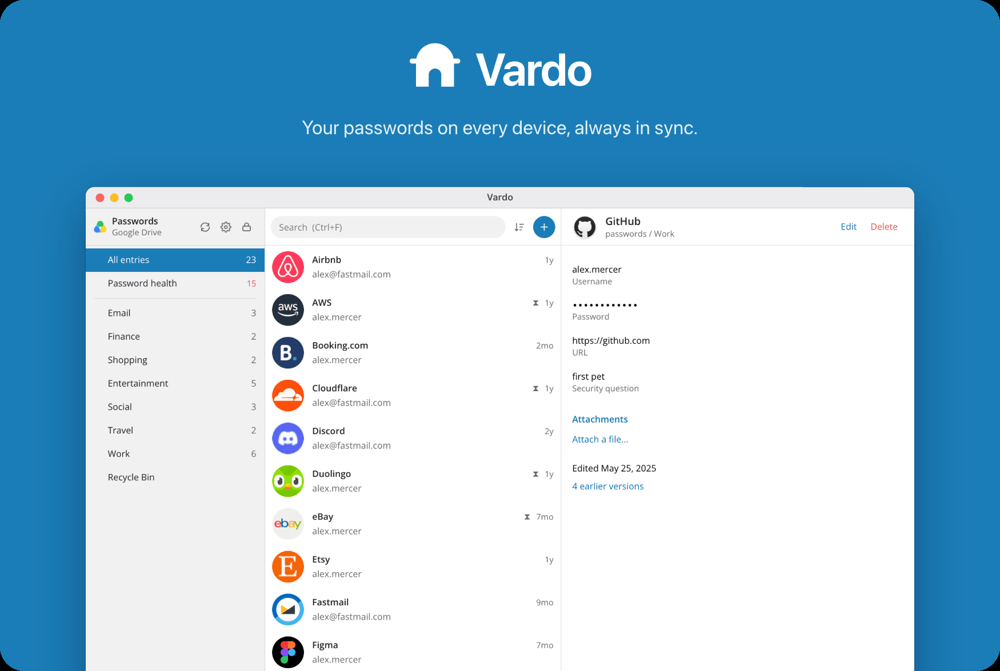
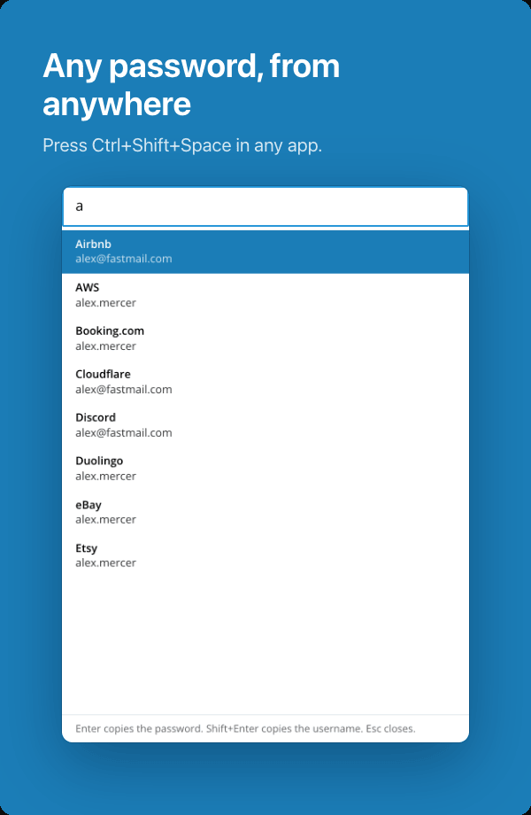
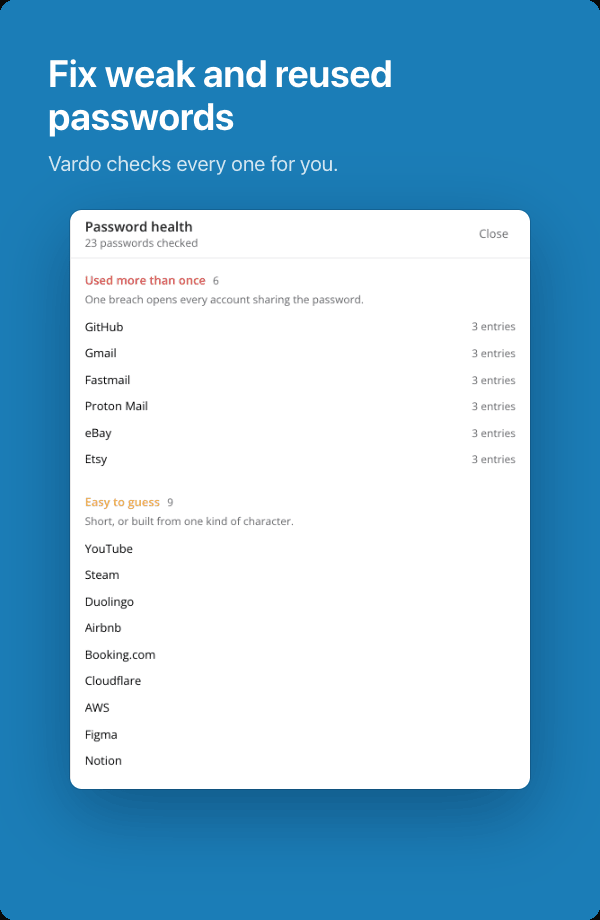
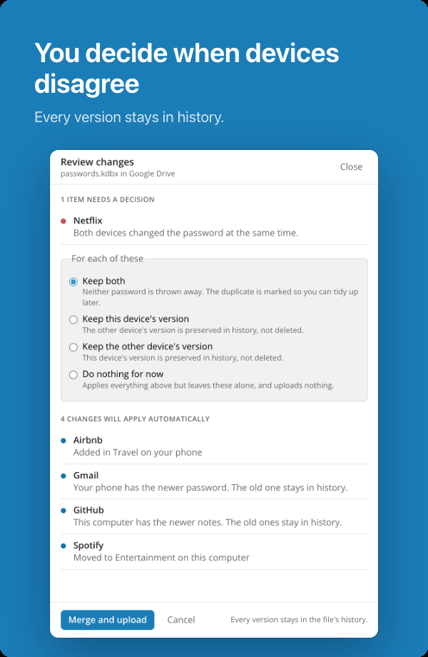

<picture>
  <source media="(prefers-color-scheme: dark)" srcset="docs/images/hero-dark.png">
  
</picture>

<p align="center">
  <a href="#download"></a>
  <a href="#download"></a>
  <a href="#download"></a>
  <br>
  <a href="#download"></a>
  <a href="https://apps.apple.com/app/keepassium-password-manager/id1435127111"></a>
  <a href="https://play.google.com/store/apps/details?id=com.kunzisoft.keepass.free"></a>
</p>

<p align="center">
  <a href="https://github.com/cornellsh/vardo/actions/workflows/ci.yml"></a>
  <a href="#license"></a>
</p>

Vardo keeps your passwords in one encrypted file, in your Google Drive or on your own server. The app, the browser extension and the KeePass app on your phone all open that file, so every device sees the same list.

<p align="center">
  <picture>
    <source media="(prefers-color-scheme: dark)" srcset="docs/images/tile-quick-dark.png">
    
  </picture>
  <picture>
    <source media="(prefers-color-scheme: dark)" srcset="docs/images/tile-health-dark.png">
    
  </picture>
  <picture>
    <source media="(prefers-color-scheme: dark)" srcset="docs/images/tile-sync-dark.png">
    
  </picture>
</p>

## What it does

- Fills your logins in the browser.
- Makes strong passwords and flags weak or reused ones.
- Stores two-factor codes, notes and files.
- Finds any password from anywhere with Ctrl+Shift+Space.
- Locks itself and clears copied passwords.

## Private

No account. No subscription. No Vardo server. Your file is encrypted before it leaves your device, and only your master password opens it. If you forget that password, nobody can recover it.

## Already use KeePass?

Vardo opens your existing file as it is. Nothing to import.

## Download

Coming soon. Until then, you can build it yourself.

<details>
<summary>Build from source</summary>

You need Rust 1.89+, Node 22, and your system's build tools (on Linux, WebKitGTK 4.1 and an AppIndicator library).

```sh
git clone https://github.com/cornellsh/vardo
cd vardo/app
npm ci
npm run app:release
```

The app lands in `target/release/vardo-app`. Try it with `fixtures/test_db_kdbx4_with_password_argon2id.kdbx`, password `demopass`.

Google Drive sync needs your own Google sign-in key ([how](docs/RUNBOOKS.md#create-a-google-oauth-client)). The browser extension is in `extension/`; connect it from Settings in the app.

</details>

## License

[Apache 2.0](LICENSE-APACHE) or [MIT](LICENSE-MIT), your choice.
